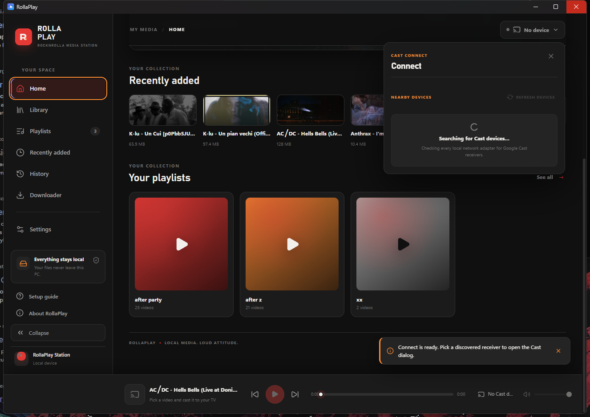
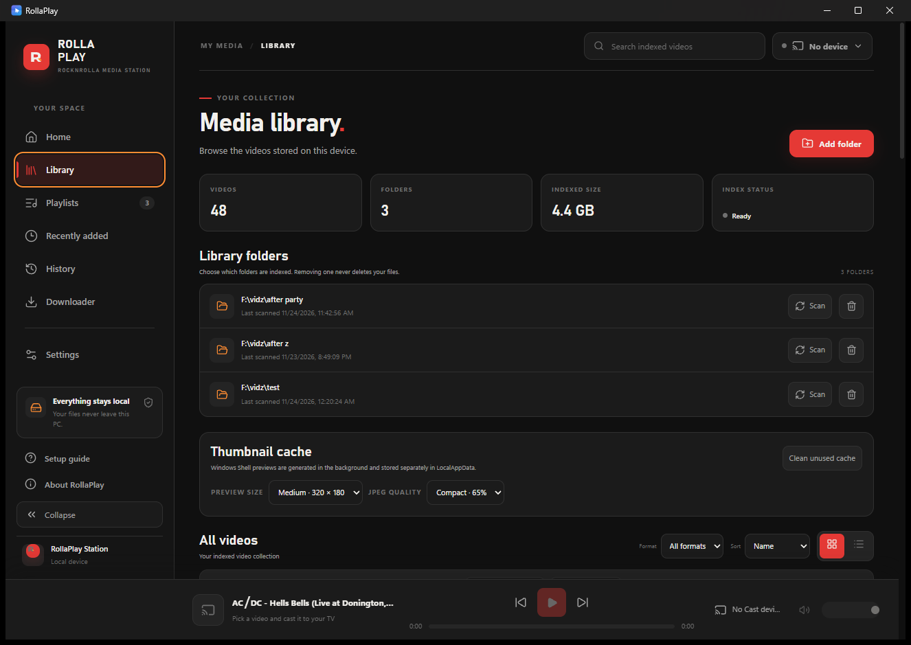
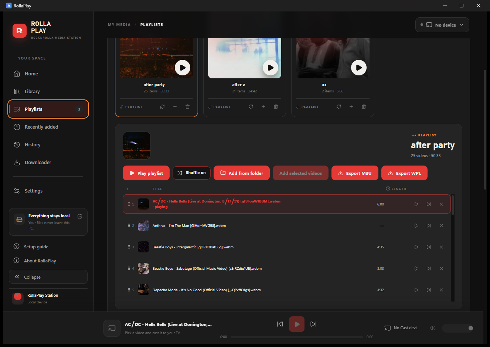
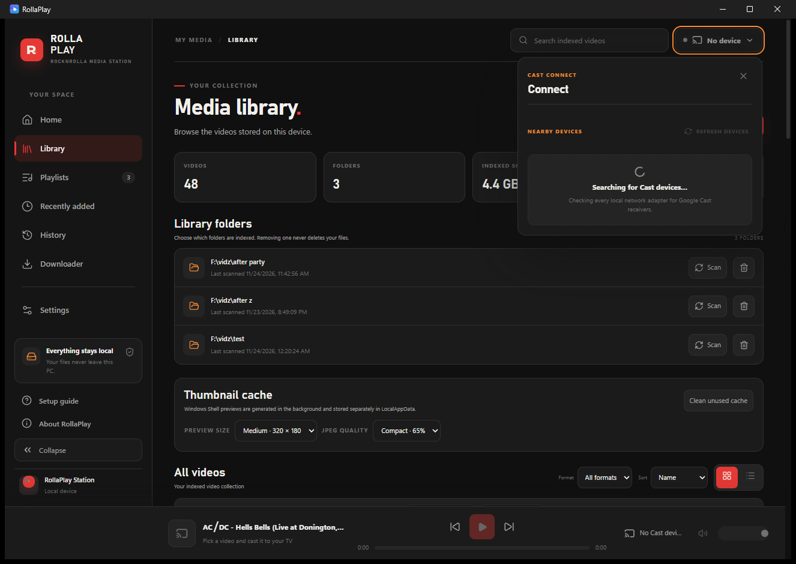
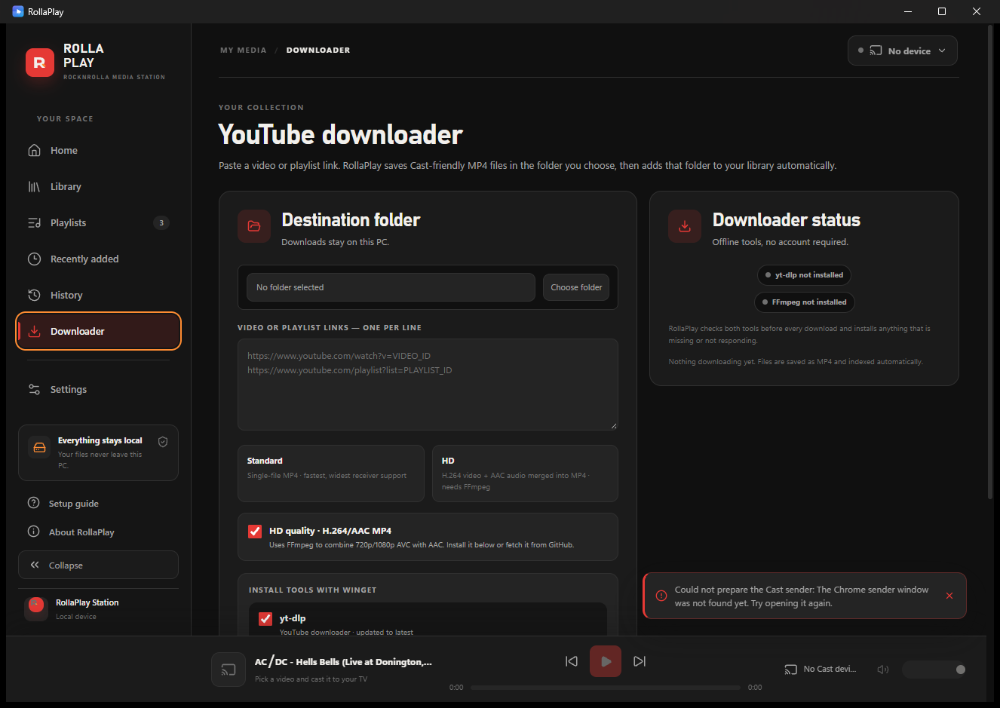
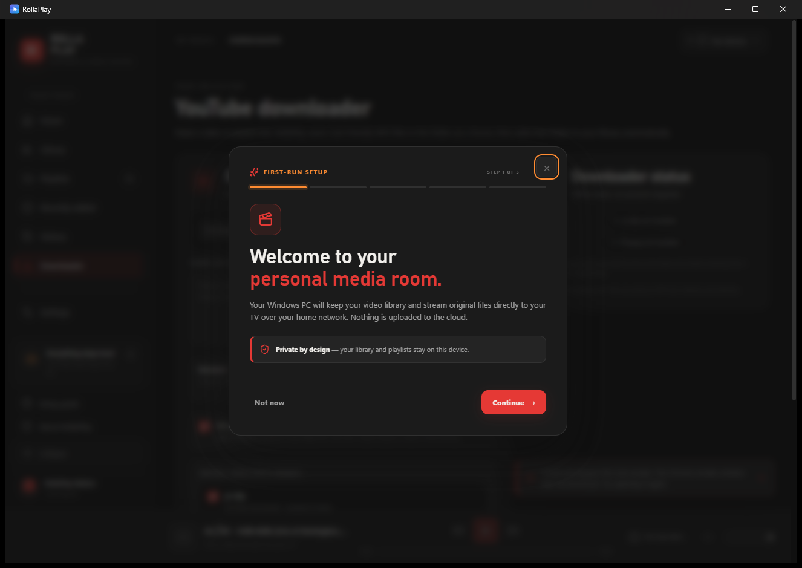
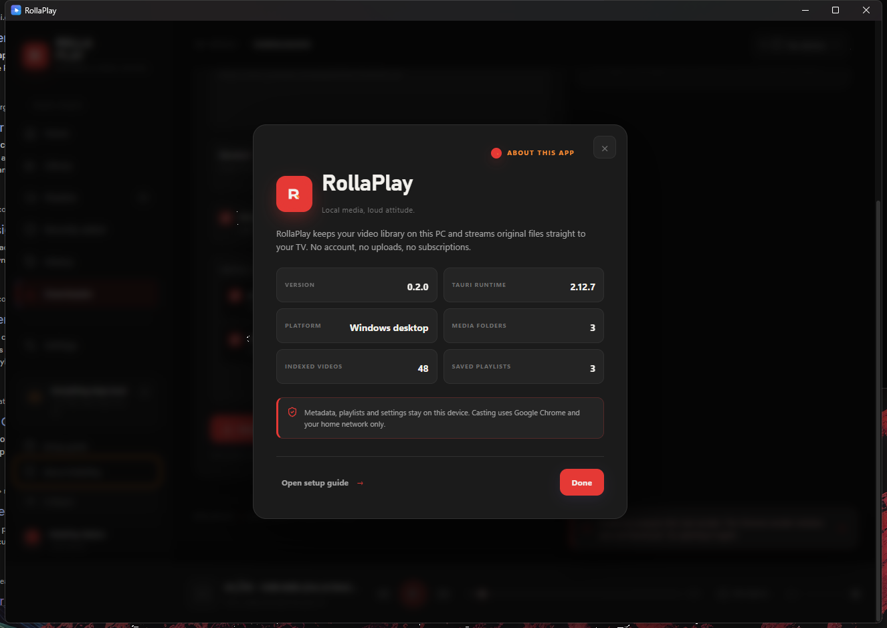

# RollaPlay

RollaPlay (the RockNRolla Media Station) is a local-first Tauri 2 desktop app for organizing video files on a Windows PC and streaming them with Google Cast. **Local media. Loud attitude.** The React/Vite interface is the controller; Rust owns directory access, indexing, SQLite persistence, thumbnail work, the LAN media server, and the Cast sender bridge. The browser preview intentionally does not simulate Windows filesystem access or Cast behavior.

## What you get

- **Local library:** add approved folders, scan incrementally, browse a poster grid with Windows Shell thumbnails, search, sort, and play with a single click.
- **Playlists:** create and edit playlists, import/export M3U, M3U8 and WPL, add videos from a folder with one click, and browse Spotify/YouTube-style cards with track tables. Playing a whole playlist advances only when the receiver reports a real `IdleReason.FINISHED`.
- **Playback queue:** reorder by dragging the grip or with the arrow buttons, use `Play next in queue` on any row, and clear watch history without disturbing playlists or the queue.
- **Cast:** real `_googlecast._tcp.local.` discovery fills an app-owned device menu under the Cast pill. Selecting a receiver opens Chrome's native Cast picker from a fully hidden embedded sender. There is no floating sender window and no "This PC" receiver.
- **Downloader:** paste a YouTube video or playlist link, pick a folder, and get Cast-friendly H.264/AAC MP4 files that are indexed into the library automatically. Optional HD mode fetches FFmpeg on first use.
- **Polished shell:** collapsible sidebar (preference persisted), Home playlist shelf, real Recently added and History pages, an About dialog with build details, and an exit confirmation that still shuts down cleanly.

## Screenshots

Captured from the native Windows app after the 0.3.0 visual polish pass. Click any image to open the full-size capture.

<table>
  <tr>
    <td align="center" width="50%">
      <a href="docs/screenshots/home.png"></a><br>
      <strong>Home</strong> — contextual hero action, real recently added artwork, and playlist shelf.
    </td>
    <td align="center" width="50%">
      <a href="docs/screenshots/library.png"></a><br>
      <strong>Library</strong> — poster grid, grouped selection actions, search, sort, filter, and thumbnail controls.
    </td>
  </tr>
  <tr>
    <td align="center" width="50%">
      <a href="docs/screenshots/playlist.png"></a><br>
      <strong>Playlist</strong> — generated artwork, duration, current-track state, and delete confirmation.
    </td>
    <td align="center" width="50%">
      <a href="docs/screenshots/connect.png"></a><br>
      <strong>Connect</strong> — app-owned picker with real discovered receivers and state labels.
    </td>
  </tr>
  <tr>
    <td align="center" width="50%">
      <a href="docs/screenshots/downloader.png"></a><br>
      <strong>Downloader</strong> — URL, destination, quality choice, and live tool/progress states.
    </td>
    <td align="center" width="50%">
      <a href="docs/screenshots/setup.png"></a><br>
      <strong>Setup</strong> — guided folders, scan, discovery, and finish steps.
    </td>
  </tr>
  <tr>
    <td align="center" colspan="2">
      <a href="docs/screenshots/about.png"></a><br>
      <strong>About</strong> — shared Rolla mark, build details, and no runtime font services.
    </td>
  </tr>
</table>

## Architecture

- **Desktop UI:** React, TypeScript, Vite, Lucide, dark media-center layout styled in `src/styles.css` and tokenized in `src/redesign.css`.
- **Native backend:** Tauri 2 commands, SQLite in the app-local data directory (`app.windowsmediastation.local`), and Tokio-backed blocking tasks for filesystem scans and Windows Shell work.
- **Media indexing:** recursive, non-symlink-following scans of approved folders. Paths, sizes, and high-resolution modification timestamps drive incremental updates. Folder removal and missing files never delete physical media or playlist references.
- **Thumbnail engine:** Windows `IShellItemImageFactory::GetImage` with `SIIGBF_THUMBNAILONLY`. COM and Shell extraction run away from the UI thread. Generated JPEGs are in `$LOCALAPPDATA/app.windowsmediastation.local/thumbnails`; SQLite stores source metadata, cache path, dimensions, quality, status, and errors—not image bytes. Unsupported or unavailable Shell thumbnail providers yield a generic card and an actionable error.
- **Embedded HTTP media server:** Axum/Tokio binds only to a selected active RFC1918 IPv4 adapter, defaults to port 8765, and tries a fallback port range on conflicts. `GET`/`HEAD /media/{media_id}` resolves only indexed files and streams them in chunks with single-range 206 and invalid-range 416 handling; multipart ranges are deliberately rejected with 416. Canonical-root checks and capability-relative file opening protect approved directories; MIME is signature-first with a safe extension fallback. Requests require a bearer token; Windows persists it encrypted with user-scoped DPAPI. The token is revealable/copyable only through the local Tauri Settings view for deliberate pairing with a trusted device, and is never included in diagnostics or logs. Local-origin-only CORS is enabled for media requests. Status/settings are Tauri commands rather than LAN admin routes; `/health` is token-protected.
- **Cast streaming grants:** Google Cast receivers cannot send `Authorization` headers, so the media server also accepts a short-lived, media-scoped `cast_token` query credential. Grants live only in memory (12-hour sliding validity, 24-hour absolute ceiling, at most 8 live grants), authorize exactly one media id each, renew on receiver use, are revoked when the user stops playback, and never touch disk, logs, or diagnostics.
- **Google Cast sender:** the official Web Sender SDK needs Chrome, so Rust detects a Chrome installation (registry `App Paths` first, then well-known install locations), runs a loopback-only bridge on `127.0.0.1:8790–8819` serving a dedicated sender page (`src-tauri/cast-sender/`), and launches Chrome in application mode against that secure local origin. The Chrome window is re-parented into the app window as a layered, fully transparent child: no second top-level window is visible and no browser area appears in the UI. Receiver discovery uses real mDNS queries with repeated multicast/unicast probes while the list is empty. Because the Web SDK cannot select a receiver by id, choosing a device arms the selected name and injects a trusted click into Chrome's hidden `#cast-trigger` so the native picker opens with that name as guidance. No connected state is reported until a real session event arrives. The desktop app remains the primary controller: casting a library video starts the media server and sender, generates a scoped streaming URL on the current LAN IPv4, and hands only the URL, MIME type, and title to the sender. Receiver state and `RemotePlayerController` events come back through the bridge (no frontend timers). The seek bar interpolates receiver-reported position for display only and never drives playlist advancement. Closing the app asks for confirmation, then stops receiver playback, shuts down the server, detaches the sender, stops Chrome, and destroys the window in that order. Watch history can be cleared from the History page. Playback state is persisted to SQLite (`playback_state`, `playback_history`) so disconnects and restarts never lose the current media reference. Cast diagnostics in Settings never display credentials.
- **M3U/WPL playlists:** `.m3u`, `.m3u8` and `.wpl` files are scanned as playlists, not video media. Imports resolve references only to already indexed files under active roots; remote URLs are skipped, WPL UTF-16 BOMs and XML entities are handled, deleted imports are tombstoned, and exports write UTF-8 M3U/M3U8 or UTF-16LE WPL.
- **Direct play only:** Cast streams the original indexed files — no transcoding or remuxing at playback time. A built-in **Downloader** fetches Cast-friendly H.264/AAC MP4s from YouTube links and playlists so receiver-side codec mismatches are avoided before indexing.

## Build and run

Prerequisites on Windows: Node.js with pnpm 12, a Rust toolchain (Cargo), WebView2 runtime, and the Visual Studio C++ build tools used by Tauri. NSIS and WiX are needed only for installers.

```powershell
pnpm install
pnpm dev                 # Vite preview at http://localhost:5173 (UI only)
pnpm build               # type check + production bundle in dist/
pnpm test                # updater state-machine and release-note tests
cargo test --manifest-path src-tauri/Cargo.toml
pnpm tauri build         # app + NSIS and MSI installers
```

Installers land in `src-tauri/target/release/bundle/nsis/RollaPlay_0.3.1_x64-setup.exe` and `src-tauri/target/release/bundle/msi/RollaPlay_0.3.1_x64_en-US.msi`. Generated folders (`node_modules`, `dist`, `src-tauri/target`, `src-tauri/gen`, `.backup`) are gitignored and never committed. Screenshots are documentation assets for the README gallery only; do not attach them to GitHub releases.

App data (SQLite database, thumbnail cache, diagnostics log) lives under `%LOCALAPPDATA%\app.windowsmediastation.local`. Setup completion is tracked locally as `wms.setup.completed`, and the sidebar preference as `wms.sidebar.collapsed`.

## Signed updates

**About → Software updates** checks the official GitHub Releases manifest, shows real signed release notes and byte-level download progress, and only installs after you choose **Download & Install**. It never installs silently, never downgrades, and never accepts unsigned artifacts. NSIS installs stay on signed NSIS builds; MSI installs stay on signed MSI builds. A separate **Restart Now** action is shown after installation; Windows may close the app while launching the installer, in which case reopen it from the Start menu. The signed 0.3.0 → 0.3.1 update flow has been validated end to end on Windows.

Releases are published by `.github/workflows/release.yml` from stable `v*` tags. The private signing key lives only in GitHub Actions Secrets; the public key is embedded in `src-tauri/tauri.conf.json`. See `docs/updater-release-guide.md` for key generation, secure backup, rotation, release steps, failure handling and the real-app E2E checklist, and `docs/updater-e2e-0.3.1.md` for the recorded 0.3.1 PASS. Screenshots remain documentation assets and are not attached to releases.

## Thumbnail defaults

The default grid preview is 320 × 180 at JPEG quality 82. The library screen offers small, medium, and large presets and three quality levels. Cache entries are invalidated when indexed file size or modification timestamp changes. A refresh action retries failed extractions; cache cleanup removes orphaned and interrupted temporary files.

## YouTube Downloader

Open **Downloader** in the sidebar, choose a destination folder, and paste one video link or a whole playlist link (one link per line). RollaPlay downloads Cast-friendly **H.264/AAC MP4** files, adds the folder to your library, and scans it automatically — the new videos appear in Recently added and can go straight into a Cast playlist.

The installer stays small: no third-party binaries are bundled. In the Downloader you can tick **yt-dlp** and/or **FFmpeg** and press **Install selected with WinGet** — the app runs `scripts/install-downloader-tools-winget.ps1` against the official WinGet packages and streams progress into the status card. The app also probes both tools with `--version` / `-version` when the Downloader opens, before every download and after a failure; anything missing or not responding is installed automatically (WinGet first, GitHub fallback). Discovery always prefers the app-local copy in `%LOCALAPPDATA%\app.windowsmediastation.local\bin`, so a stale WinGet folder cannot shadow it. **Prepare from GitHub** (shown as **Refresh tools from GitHub** when the tools look ready) updates existing releases there with an atomic replace instead of skipping them, which fixes tools that appear ready but fail intermittently or briefly show "not responding". **Standard quality** uses a progressive 360p MP4 and needs no FFmpeg. Tick **HD quality** to merge 720p/1080p AVC video with AAC audio. Only public YouTube links are accepted; private or sign-in-only links show a clear error, and downloads run without a shell and can be cancelled.

Tick **Convert to TV-friendly MP4** to check the downloaded file's real audio and video streams with FFmpeg. Files that are already H.264/AAC in an MP4 container are kept as-is; unsupported files are re-encoded to H.264/AAC MP4 with `faststart`, verified again, and only then replace the original. A failed or cancelled conversion keeps the original. This option needs a working FFmpeg and works with either quality setting.

This matters because the Cast Default Media Receiver on many TVs cannot decode **AV1/VP9** — those WebM files play audio but show a black picture. RollaPlay never transcodes during playback; the Downloader can save a compatible copy up front.

## Data and availability

SQLite migrations add explicit media and directory availability states:

- `available` — visible in the library.
- `temporarily_unavailable` — drive/root disappeared or could not be read; file and playlist rows are retained.
- `partially_unavailable` — a scan encountered inaccessible paths; unobserved files are not declared permanently missing.
- `permanently_missing` — a complete scan confirmed a file is absent.
- `removed_from_library` — the user removed the folder; physical files and playlist rows remain untouched.

A scan is transactional. Cancelling or interrupting it before commit discards partial index changes. Duplicate concurrent scans of the same folder are rejected. Unique path/size/modified-time matches are used to recognize likely renames while avoiding ambiguous matches.

## Development and tests

Rust tests are defined in `src-tauri/src/lib.rs`, `src-tauri/src/media_server.rs`, `src-tauri/src/network.rs`, `src-tauri/src/cast_discovery.rs`, `src-tauri/src/cast_sender.rs`, `src-tauri/src/downloader.rs`, `src-tauri/src/playlist.rs`, `src-tauri/src/playlist_file.rs`, `src-tauri/src/secret.rs`, and `src-tauri/src/thumbnail.rs`. The native Windows Shell thumbnail test is ignored unless a sample video is supplied through `WMS_TEST_VIDEO`, and can be enabled on Windows with `cargo test --manifest-path src-tauri/Cargo.toml windows_shell_extracts_and_encodes_a_video_thumbnail -- --ignored`.

Cross-platform Rust unit tests cover cache safety/invalidation, migrations, scan cancellation/duplicates, rename and availability behavior, playlist preservation, M3U/WPL parsing/export and import tombstones, queue reorder and completion semantics, full/HEAD/range streaming, auth/path checks, MIME fallback, large/concurrent/interrupted streams, local CORS, port fallback, Cast streaming grants (scoping/expiry/revocation), receiver query-token authentication over HTTP, mDNS response parsing, Chrome detection/launch commands, sender asset hygiene, and Cast playback persistence.

The browser preview can verify UI layout and interactions only. Folder scanning, Tauri commands, Windows Shell extraction, drive-unplug behavior, Chrome sender behavior, real Cast discovery, and installer behavior require the native desktop app.

## Changelog

See [CHANGELOG.md](CHANGELOG.md) for release notes and unreleased changes.

## License

RollaPlay is licensed under the [PolyForm Noncommercial License 1.0.0](LICENSE) (SPDX: `PolyForm-Noncommercial-1.0.0`). Use, changes, and distribution are permitted for noncommercial purposes; commercial use requires a separate agreement with the licensor.

## Validation status

On Windows the frontend build, Rust tests (82 passed, 1 ignored), and packaged NSIS/MSI builds have all been verified; recorded results are in [docs/windows-validation.md](docs/windows-validation.md). The user validated LAN Chromecast playback, receiver controls and automatic `IdleReason.FINISHED` playlist advance on 2026-11-23 with the rebuilt installer. Unsupported AV1/VP9 sources are addressed by the in-app Downloader, which saves H.264/AAC MP4 copies. The user also confirmed that a public YouTube download now completes with the installed tools and the MP4 files appear in the chosen folder. Hardware/Cast results are user-reported without per-item logs or screenshots.
